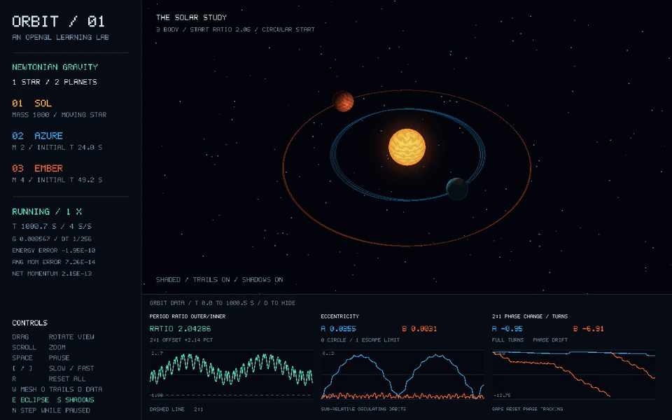

# Orbit / 01

A small C++ / OpenGL project for learning graphics through a Newtonian three-body
simulation: one star, two planets, mutual gravity, eclipse shadows, and orbital
diagnostics. A companion Three.js viewer replays exported simulation data in a browser.



[Download the 15-second MP4](doc/assets/orbit-lab.mp4) ·
[WebGL viewer source](doc/index.html) ·
[Code walkthrough](doc/DEVELOPMENT.md)

The GIF shows the native app's client area, with the circular preset at 1× playback.
It is a screen recording, not a render of the browser viewer.

## Native application

Requirements: a C++17 compiler, CMake 3.16+, GLFW 3.3+, GLEW, and an OpenGL 3.3 Core
capable graphics environment. Development and graphics checks were performed on Linux / WSLg.

On Debian / Ubuntu:

```bash
sudo apt install build-essential cmake libgl1-mesa-dev libglfw3-dev libglew-dev
./run.sh
```

The launcher builds the app and checks the selected renderer. It prefers NVIDIA
on WSLg and falls back to Mesa software rendering if the graphics check fails.
Another adapter can be selected with `MESA_D3D12_DEFAULT_ADAPTER_NAME=Intel ./run.sh`.

To build and run directly:

```bash
cmake -S . -B build -DCMAKE_BUILD_TYPE=Release
cmake --build build --parallel 2
./build/solar_system
```

The default preset starts with nearly circular orbits and an outer/inner period
ratio of **2.05**. Displayed **1×** advances **four simulated seconds per real second**.
All three bodies move; total initial linear momentum is zero in the barycentric frame.

```bash
./run.sh --resonance              # Chosen eccentricities and phases: a resonance candidate
./run.sh --resonance --time 1000  # Integrate forward and start with populated plots
```

| Input | Action |
| --- | --- |
| Left drag / scroll | Rotate / zoom the camera |
| Space / N | Pause or resume / advance 0.125 simulated second while paused |
| `[` / `]` | Halve / double playback speed |
| W / O / D | Toggle wireframe / trajectory trails / diagnostic plots |
| E / S | Inspect the next alignment / toggle eclipse shadows |
| R / Escape | Reset the selected preset / close |

Shader files are loaded at startup from the source directory. Keep that directory
available, and reconfigure CMake after moving it.

## Browser viewer

```bash
python3 -m http.server 8000 --directory doc
```

Open **http://localhost:8000**. The page provides camera controls, playback speed,
a scrubber, both starting presets, trails, shadows, and recorded diagnostics.
Three.js **0.187.0** and OrbitControls are bundled locally with their MIT license;
the viewer makes no CDN requests and requires no npm build.

This is a **replay**, not a JavaScript port of the physics engine. The C++ solver
exports compact little-endian float32 files. Three.js interpolates the recorded
positions and renders them using adapted GLSL shaders. Each preset contains 2048
simulated seconds and is about 0.92 MB. At the end, playback restarts at the beginning.

GitHub's repository file viewer does not execute HTML. Serve `doc/` locally or
deploy its contents to a static host such as GitHub Pages. See the
[viewer and binary-format notes](doc/README.md).

Regenerate the data after changing the physical parameters:

```bash
./build/orbit_export doc/data
```

## Physics and numerical method

Every pair contributes Newtonian gravitational acceleration. Positions and
velocities use double precision, with a fixed **1/256-simulated-second**
kick–drift–kick leapfrog step. Playback speed changes the number of steps, not
their size. Trails show the actual simulated barycentric paths.

The units are arbitrary but consistent: **G = 0.00856736493150118**, with masses
**1000, 2, and 4** for Sol, Azure, and Ember. The initial semimajor axes are **5**
and approximately **8.07411**. Spins are prescribed prograde animation; spin
torques, tidal dissipation, gas drag, and general relativity are not modeled.
Surface contact pauses the simulation. Eclipse shading approximates overlap of
the sun's apparent disk with the other planet's disk, including partial shadows.

## What do we observe about resonance?

**The ordinary circular run has not demonstrated spontaneous capture into a
permanent synchronized state.** The period ratio and eccentricities vary, and
critical angles can drift or oscillate. We do not infer resonance from an
elliptical-looking trail or from a period ratio close to an integer alone.

For the 2:1 relationship, the diagnostics follow
`phi_i = 2 lambda_Ember - lambda_Azure - periapsis_i`, using sun-relative osculating
elements. Repeated full turns indicate circulation. Bounded oscillation is
consistent with libration, but apparent libration can be misleading, especially
for nearly circular orbits. Undefined periapsis directions produce gaps rather
than a fabricated synchronization score.
[Delisle et al., 2012](https://doi.org/10.1051/0004-6361/201220001)

The optional `--resonance` preset chooses eccentricities **0.30 and 0.12**, aligned
periapsides, and selected phases at the same initial period ratio of 2.05. In a
16384-simulated-second test, both critical angles stayed bounded, spanning about
**0.20 and 0.45 turns**. That is a finite numerical observation of a promising
configuration, not evidence of spontaneous capture, a zero-amplitude final state,
or indefinite stability.

Newtonian gravity supports resonant motion without making its oscillations fade.
Our conservative point-mass model has no dissipative process that would cause
relaxation toward an attractor. Tides or interaction with a gas disk can change
capture and damping behavior, and can also disrupt a resonance; general
relativity is not required to model those processes.
[Resonance and dissipation study](https://doi.org/10.1051/0004-6361/201423676)

## Verification and reproducibility

```bash
ctest --test-dir build --output-on-failure
./run.sh --smoke-test
./run.sh --resonance --smoke-test
```

Tests cover gravitational forces, conservation, convergence, frame-rate
independence, spin directions, eclipses, orbital elements, the bounded-angle
candidate, binary exports, and replay interpolation. Python and Node tests are
added when their interpreters are available. Graphics checks require a desktop
display. Optional browser QA is provided by `tools/check-viewer.py` and requires
Python Playwright, Pillow, and Chromium.

To regenerate the 15-second MP4 and GIF on an X11 / WSLg desktop:

```bash
./tools/record-demo.sh
```

This requires FFmpeg and `xwininfo` (`ffmpeg` and `x11-utils` on Debian / Ubuntu).
It captures only a dedicated app window, without desktop borders or audio.

The [development guide](doc/DEVELOPMENT.md) explains the files, shader pipeline,
integration, and diagnostics in more detail. See [third-party notices](THIRD_PARTY_NOTICES.md)
for bundled library attribution.

To prepare a clean source ZIP for publication, run `python3 tools/package-source.py`.
The archive is written to `dist/orbit-lab-source.zip` and contains the source,
documentation, viewer, data, and demo media. Local builds and workspace settings
are excluded.
