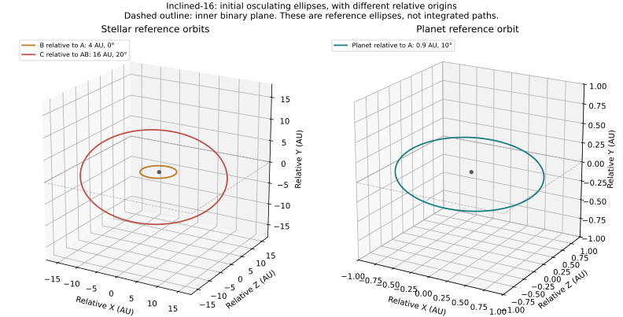
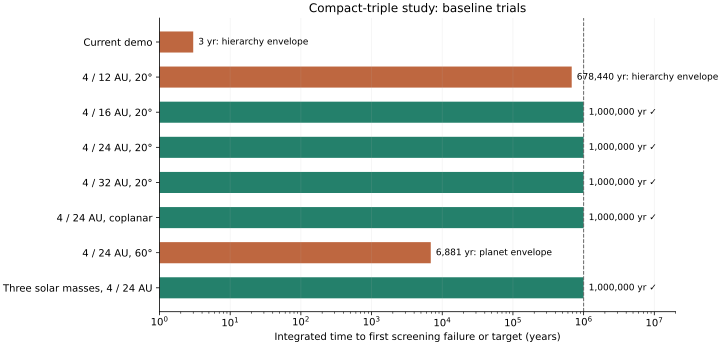

# Compact three-star systems over one million years

Research completed 20 November 2026. The original interactive world is preserved
as Orbit-02-01. The inclined-16 candidate is now available separately as
[Orbit-02-03](orbits/Orbit-02-03.md), with a native demo and million-year records.

**A compact, inclined configuration retaining the planet passed one million
years in this model.** The most compact candidate tested successfully has a
4 AU A/B binary, a 16 AU outer orbit for C, and a 0.90 AU planet around A.
The outer stellar orbit starts 20° from the inner binary plane; the planet
starts 10° from that plane. It passed a finer timestep and two nearby starting
conditions as well. This is finite numerical evidence for a candidate, rather
than a mathematical stability proof or a search for the absolute smallest system.

The later [three-sun dance investigation](SUN_DANCE.md) broadens the search to
a published nonhierarchical spatial orbit, drops the binary-retention requirement,
and validates a planet orbiting the whole triple. It includes an animated sky
preview and four successful million-year trials of the new candidate. The
hierarchical results below remain a separate comparison.

## The novel, the adaptation, and missing parameters

The [official Netflix episode 3 recap](https://www.netflix.com/tudum/articles/3-body-problem-episode-3-recap)
explains stable eras as a planet orbiting one sun, with chaotic eras when it is
pulled away among the three. It does not give a reproducible set of masses,
positions, velocities, or orbital inclinations. A dramatic alignment in the
adaptation cannot establish that every orbit shares a fixed plane.

The novel evidence is incomplete here. The authorized
[Macmillan excerpt of Liu Cixin's novel, translated by Ken Liu](https://us.macmillan.com/books/9780765377067/thethreebodyproblem/)
contains the opening historical chapter, rather than the later orbital
explanations. No passage specifying a common plane, exact stellar masses, or
complete initial conditions has been verified in this investigation. This is
not a claim that the full novel never discusses those matters. We should label
our numerical choices as fiction inspired, rather than canonical reconstruction.

The existing [mass references](ORBIT_02.md#what-masses-can-we-justify) remain
1.0788, 0.9092, and 0.1221 solar masses. Those are real Alpha Centauri reference
measurements, not fictional measurements. Real Proxima is much farther away:
[Kervella et al. (2017)](https://arxiv.org/abs/1611.03495) estimate an outer period
of about 550,000 years. Our compact 16 AU outer orbit is a different system.

## Do the stars and planet have to share a plane?

No. Three noncollinear instantaneous stellar positions always define a plane;
that geometric fact does not require their velocities or future paths to stay
in it. The meaningful comparison uses orbital angular momenta: the A/B relative
orbit, C relative to the A/B barycentre, and the planet relative to its host.
Their mutual inclination is the angle between the corresponding angular
momentum vectors.

The current demo already starts with a **6.629° stellar mutual inclination**.
Its planet starts in the A/B orbital plane, at 0°. It is therefore nearly
coplanar, without a constraint that forces subsequent motion into one plane.
An orbital camera can make a small inclination difficult to notice.

[Busetti, Beust & Harley (2018)](https://arxiv.org/abs/1811.08221) numerically
investigate planetary stability in hierarchical triples over a range of
inclinations and orbital arrangements. Their results support studying inclined
configurations and distinguish planets orbiting one star from those orbiting a
binary or the whole triple. Stability in one arrangement does not establish
stability in another.



These are **initial osculating reference ellipses**, not integrated future
trajectories. The left panel uses B relative to A and C relative to the A/B
barycentre; the right panel uses the planet relative to A. Their origins differ.
The dashed outline marks the inner binary plane. The calculations include the
motion of every star and do not fix any star or barycentre in space.

## Which configurations are plausible?

A hierarchical triple is a practical starting point: an inner pair plus a
more distant third star, with a planet well inside its host's region. Separation
ratio, eccentricity, inclination, masses, and starting phases all matter.
[Vynatheya et al. (2022)](https://arxiv.org/html/2207.03151v2) discuss these effects
and improve empirical stellar stability criteria. Such criteria are screening
tools; they do not certify a planet's million-year survival.

For context, the Mardling–Aarseth criterion as reproduced in their equation 2
can be written as:

```text
q = m_C / (m_A + m_B)
a_outer / a_inner > 2.8 / (1 - e_outer)
    * [(1 + q) * (1 + e_outer) / sqrt(1 - e_outer)]^(2/5)
    * (1 - 0.3 * inclination / pi)
```

Inclination is in radians. For our reference masses, outer eccentricity 0.10,
and inclination 20°, this gives a ratio of about **3.268**. Ratios 3, 4, and 6
for the 12, 16, and 24 AU candidates therefore make useful comparisons. The
numerical experiment below supplies the actual finite-time evidence.

Hierarchical systems are not the only stable solutions. For example,
[Kapela & Simó (2011)](https://arxiv.org/abs/1105.3235) give rigorous KAM stability
results for selected figure-eight families in the planar problem.
[Li & Liao (2025; journal publication 2026)](https://arxiv.org/abs/2508.08568)
report many three-dimensional periodic solutions for two equal masses and a
range of third masses, including linearly stable examples. Those offer a future
route to more elaborate stellar choreography. They do not supply a validated
planet orbit for our unequal A/B masses; that would require a separate study.

## Experiment and operational definition

The new headless `stellar_stability` executable reuses the existing double
precision Newtonian kick–drift–kick solver. Candidate states are constructed in
Jacobi coordinates, including barycentric recoil and the correct masses in each
initial Kepler orbit. Units are AU, solar masses, and Julian years, with G = 4π².
The fourth body is the same massless planet model used by Orbit / 02.

Each trial targets **1,000,000 years**, stopping at its first screening failure.
To count as a pass, all sampled diagnostics must satisfy:

- Every stellar pair remains within 100 AU, with no detected surface contact.
- The A/B and C–AB osculating orbits remain bound, with semimajor axes between
  0.5 and 2 times their initial values.
- The planet remains bound to A in its host-relative osculating elements,
  within 5 AU, with semimajor axis between 0.5 and 2 times its initial value.
- Relative stellar energy error remains below 10⁻⁴ and relative angular
  momentum error below 10⁻⁸.

This definition is deliberately stronger than merely keeping the stars compact:
it also retains the original hierarchy and the planet's host. **A failed
hierarchy envelope does not mean a star escaped. A failed planet criterion does
not mean the stars disrupted.** No continuation after a failure is implied.

The baseline step is 1/512 year, or 512 million steps per completed trial.
Diagnostics are sampled every 0.125 year; checkpoint CSVs are written every
128 years. Surface contact is checked at step endpoints. Reported extrema are
sampled extrema, not continuous bounds, and sparse CSVs cannot reconstruct all
orbital cycles. The normal viewer retains its existing 1/16384-year step.

All new hierarchical cases use inner eccentricity 0.05, outer eccentricity 0.10,
and planet eccentricity 0.03. Unless stated otherwise, stellar inclination is
20°, planet inclination 10°, and planet semimajor axis 0.90 AU. The equal-mass
case uses three 1-solar-mass stars, each assigned 1 solar luminosity, and a
0.75 AU planet. These are invented comparison parameters.

## Results

The tracked [results JSON](experiments/stability/results.json) contains **18
trials**, exact initial positions and velocities, commands, numerical diagnostics,
compiler information, and source hashes. Eight baseline configurations give:

| Configuration | Stellar axes, AU | Initial stellar / planet inclination | Baseline outcome | Largest sampled star separation, AU |
| --- | --- | --- | --- | --- |
| Current demo | Original scattering state | 6.629° / 0° | Hierarchy envelope fails at 3 yr | 7.33 before stop |
| Coplanar control | 4 / 24 | 0° / 0° | Passes 1,000,000 yr | 28.45 |
| Inclined, tighter | 4 / 12 | 20° / 10° | Hierarchy envelope fails at 678,439.625 yr | 30.04 before stop |
| **Inclined, compact candidate** | **4 / 16** | **20° / 10°** | **Passes 1,000,000 yr** | **19.68** |
| Inclined, wider candidate | 4 / 24 | 20° / 10° | Passes 1,000,000 yr | 28.49 |
| Inclined, widest tested | 4 / 32 | 20° / 10° | Passes 1,000,000 yr | 37.30 |
| Higher stellar inclination | 4 / 24 | 60° / 10° | Planet envelope fails at 6,881.125 yr | 28.35 before stop |
| Three equal solar masses | 4 / 24 | 20° / 10° | Passes 1,000,000 yr | 28.38 |



The 16 and 24 AU candidates each pass four million-year trials: baseline,
half timestep, and two perturbations. Each perturbation jointly offsets the
outer and planetary initial true anomalies by ±1° and the outer inclination by
±1°. These are two nearby samples, not a statistical survival rate or an
independent sweep of every angle. The equal-mass case also passes at half step.

The rejected cases remain unsuitable in finer checks. At half step, the 12 AU
case fails its hierarchy envelope at **806,840 years**. The 60° case fails its
planet binding criterion at **6,727.625 years**. These differing failure times
mean we cannot assign a precise physical lifetime from these runs; the shared
screening outcome is what is supported. The current demo fails its hierarchy
envelope at year 3 even at the viewer's finer timestep, while still compact.
This is not a statement that it ejects a star at year 3.

## Candidate for a later Orbit / 02 change

The **4 / 16 AU inclined candidate** is the most compact of the successfully
screened choices. Across its four runs:

| Quantity | Sampled range or bound |
| --- | --- |
| Maximum stellar separation | Less than 19.69 AU |
| Minimum stellar separation | Greater than 3.76 AU |
| Planet semimajor axis about A | Approximately 0.8929–0.9479 AU |
| Planet eccentricity | Below 0.095 |
| Planet inclination to the inner binary | Approximately 9.63–10.96° |
| Total incident flux, Earth = 1 | Approximately 1.617–2.176 |
| Maximum relative stellar energy error | 2.38 × 10⁻⁷ at baseline step; 5.93 × 10⁻⁸ at half step |

Initial two-body reference periods are about **5.674 years** for A/B,
**44.058 years** for C around their barycentre, and **0.822 year** for the planet
around A. The eccentricities and inclinations evolve under the full forces.
Initial nodes, periapsides, and phases are explicit in
[`src/stability.hpp`](../src/stability.hpp); the JSON initial states remove any
ambiguity about angle conventions.

The **4 / 24 AU** candidate is a wider alternative with less variation of
stellar orbital elements in these tests, also passing all four trials. The
equal-solar-mass alternative makes the third star much brighter, but moves
farther from the current measured mass references.

For the visual design, a long-lived hierarchy gives varying sun directions and
moderately varying illumination. It does not demonstrate repeated transfers of
the planet between stars or the destructive chaotic eras of the story. The flux
is an inverse-square irradiation measurement, not a climate or habitability
prediction. Choosing long retention changes that aspect of the experience.

## Numerical confidence and limitations

For the 16 and 24 AU candidates, halving the timestep reduces the maximum
stellar energy error by approximately four. Their retention outcome and broad
orbital-element bounds persist. Conservation of the stars alone cannot validate
a massless planet, so the study also uses an independent check of its orbit.

An optional [SciPy DOP853](https://docs.scipy.org/doc/scipy-1.16.0/reference/generated/scipy.integrate.solve_ivp.html)
integration independently evaluates all four accelerations for the 16 AU,
24 AU, and equal-mass candidates over **128 years**, with relative tolerance
2 × 10⁻¹² and absolute tolerance 10⁻¹³. Comparing six final osculating elements,
leapfrog error decreases by factors of about 0.22–0.26 per timestep halving,
consistent with second-order convergence. See the
[independent validation data](experiments/stability/independent-validation.json).
**This is a short independent cross-check, not a second million-year integration
or a guarantee of identical long-term phase.**

The model omits stellar evolution, tides, relativity, external encounters, and
planetary back reaction. Contact retains the viewer's physical reference radii,
even for the hypothetical equal-mass case; successful trials remain far outside
those radii. Finite timestep and diagnostic sampling cannot exclude all brief
excursions. Only two mass triplets and selected separations, eccentricities,
inclinations, and phases were tested. In particular, these results do not show
that every 12 AU or every highly inclined configuration fails.

## Reproduce

The main study needs C++17, CMake, and Python's standard library, without graphics
libraries or new simulation dependencies:

```bash
cmake -S . -B build-headless -DCMAKE_BUILD_TYPE=Release -DORBIT_BUILD_VIEWER=OFF
cmake --build build-headless --parallel 2
ctest --test-dir build-headless --output-on-failure
python3 tools/run-stability-study.py --jobs 4
```

A single candidate or control can be run directly:

```bash
./build-headless/stellar_stability inclined-16 --years 1000000 --step 0.001953125
./build-headless/stellar_stability inclined-16 --years 1000000 --step 0.0009765625
```

Each command emits a JSON result. A completed physical screening failure still
returns a result successfully; inspect its `passed` and `failure` fields.
`--output FILE` adds CSV checkpoints. Raw study CSVs stay in the ignored
`build-headless/stability-runs/` directory. Regenerate them using the runner;
the tracked JSON records the per-run commands.

The optional independent check needs NumPy and SciPy; plotting needs NumPy and
Matplotlib. These are documentation tools, not application dependencies:

```bash
python3 tools/validate-stability.py
python3 tools/plot-stability-study.py
```

Tests cover Jacobi orbital elements and masses, initial barycentre/momentum,
noncoplanar geometry, second-order short-run convergence, and preservation of
the existing viewer state. Long experiments are separate from routine CTest.

Verification for this study: the Release headless build succeeded, and all
12 CTest tests passed. Python scripts compiled successfully; report links and
recorded experiment source hashes were checked. Figures were visually inspected.
