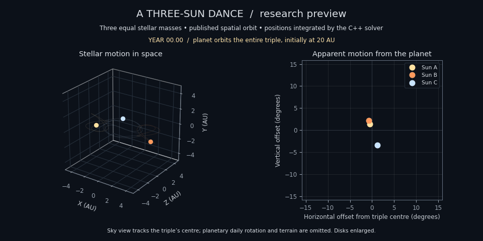

# A long-lived three-sun dance

This follow-up changes the research objective from finding a quiet hierarchy to
finding **an elaborate stellar dance that retains a planet for one million
years**. The original Orbit / 02 world is preserved as Orbit-02-01. This candidate is
now available separately as [Orbit-02-02](orbits/Orbit-02-02.md), with its own
native demo and million-year web records. The research preview below remains
a scientific diagram rather than a terrain recording.

## What “unsolvable” means

The general three-body problem has no general closed-form solution in the usual
sense; it can exhibit sensitive dependence on initial conditions. That does not
mean every triple is unstable, or that every tiny change ejects a star. Orbital
predictability, boundedness, and sensitivity are different questions. Special
stable periodic solutions exist: for example,
[Kapela & Simó (2011)](https://arxiv.org/abs/1105.3235) prove KAM stability results
for selected figure-eight families in the planar problem.

For our visual goal, exact repetition after a million years is unnecessary.
We need the system to stay compact and retain an observing planet. A periodic
or near-periodic stellar dance is an acceptable outcome. No claim of chaotic
motion is made without a separate sensitivity analysis.

## A published spatial orbit

The new experiment uses **O₃(1.0)** from
[Li & Liao, supplementary Table S4](https://arxiv.org/html/2508.08568v1).
The authors identify it as a linearly stable three-dimensional periodic orbit
for three equal masses. The published high-precision initial condition provides
a reproducible starting point; linear stability alone does not certify our
planet or our finite-precision million-year integration.

The research executable `stellar_dance` converts the published G = 1 state into
AU, solar masses, and years, with G = 4π². It maps published `(x,y,z)` into the
project's `(x,z,y)` coordinates and removes the stellar barycentre. No star is
fixed, and the trajectory is never reset to the published initial state.

| Choice | Value |
| --- | --- |
| Stellar masses | 1, 1, 1 solar masses |
| Stellar luminosities for the flux measurement | 1, 1, 1 solar luminosities |
| Length scaling of the published orbit | 4 AU |
| Initial A/B separation | 8 AU |
| Published reference period after scaling | 8.698291 years |
| Candidate planet | Initially circular, 20 AU from the stellar barycentre |
| Planet orientation | 20° to the project's XZ reference plane |

That planetary inclination is a coordinate choice, not a claim that the moving
triple has one fixed orbital plane. The planet feels all three stars and has
zero mass in their equations. Its orbit surrounds the whole triple, unlike the
planet around star A in the earlier hierarchical candidates.

## Motion preview



The 16-second clip covers the first 32 simulated years. The left panel shows
stellar positions and four years of trails in physical coordinates; faint paths
show the first reference-period interval. The right panel shows actual angular
star-to-planet directions, with the view aimed toward the triple's barycentre.
Its vertical reference uses the initial planetary orbital normal. This is a
tracking sky camera, not a surface observer's azimuth/altitude chart. Daily
rotation, atmospheric appearance, terrain, and eclipses are omitted. Disks are
enlarged, and colours distinguish the three identical stellar masses.

The preview comes from the C++ integration, not drawn paths or looping the
published period. The GIF itself repeats its finite clip for viewing. The
[64-year position record](experiments/dance/preview.csv) and
[plotting script](../tools/plot-dance-study.py) reproduce the figure.

## Million-year screening

Unlike the hierarchy study, this experiment **does not require an A/B binary
or nearly constant Jacobi semimajor axes**. Such restrictions would reject the
stellar choreography we want to investigate. It requires instead:

- All sampled stellar pair separations remain below 100 AU.
- The planet remains within 100 AU of the stellar barycentre, with negative
  instantaneous osculating energy relative to a point mass equal to the total
  stellar mass. This is a screening diagnostic for a circumsystem orbit, not an
  exactly conserved planetary energy in the time-dependent three-star field.
- Relative stellar energy error remains below 10⁻⁴ and relative angular momentum
  error below 10⁻⁸.
- No detected stellar or planetary surface contact occurs.

The diagnostics are sampled every 1/16 year. Contact checks use the original
viewer's reference physical radii at substep endpoints, including the backward
substep; they do not represent continuous collision detection. Successful
separations are much larger than those radii. The planet remains massless, so
stellar conservation checks alone do not validate it.

Six trials compare an initially 16 AU planet, the 20 AU candidate and its
variations, and a 24 AU planet. The stellar perturbation multiplies the opposite
initial vertical velocity components of A/B by 1 + 10⁻⁶, preserving zero total
momentum. A separate trial puts the planet 90° farther around its initial orbit.
These are selected nearby cases, not a statistical measure of stability.

All four **20 AU candidate** trials reached **1,000,000 years**: baseline,
half timestep, perturbed stellar velocities, and a planet starting 90° farther
around its orbit. The 24 AU comparison also reached the target.

| Trial | Time reached | Result |
| --- | --- | --- |
| Planet initially 16 AU | 8,381.625 yr | Planet crosses the 100 AU retention boundary |
| Planet initially 20 AU | 1,000,000 yr | Pass |
| 20 AU, half timestep | 1,000,000 yr | Pass |
| 20 AU, stellar velocities perturbed by 10⁻⁶ | 1,000,000 yr | Pass |
| 20 AU, initial planet phase +90° | 1,000,000 yr | Pass |
| Planet initially 24 AU | 1,000,000 yr | Pass |

Across the four candidate trials, sampled stellar separation stays below
**8.00004 AU**, with a minimum above **0.42314 AU**. The planet remains between
approximately **17.8535 and 20.7648 AU** from the barycentre. The baseline sky
separation between a pair of suns ranges up to **26.15°**, giving an extended
looping pattern rather than a single unresolved light source.

The maximum sampled stellar energy error is **8.50 × 10⁻⁶** at the baseline
step and **5.34 × 10⁻⁷** at half step, a reduction of approximately sixteen.
These are finite sampled bounds and outcomes, not guarantees for other phases
or arbitrary perturbations.

The [results JSON](experiments/dance/results.json) contains each outcome,
initial and final states, commands, extrema, source hashes, and build metadata.
The 16 AU control exceeds the planet's 100 AU retention boundary at 8,381.625
years while the stars remain compact. That result does not prove the planet
has become unbound or that the stars have disrupted.

## Integration and independent verification

Close stellar approaches need more accuracy than the original long-run
leapfrog setup provided. Initial coarse trials were rejected by the numerical
error threshold rather than counted as physical failures. This research uses
[Yoshida's fourth-order symmetric composition](https://doi.org/10.1016/0375-9601(90)90092-3)
of the existing kick–drift–kick routine, with coefficients
`w1 = 1.3512071919596576`, `w0 = -1.7024143839193153`, and `w1`.
The negative middle substep is part of the integration algorithm. It does not
reverse the displayed trajectory or alter the physical force law. The viewer's
integrator remains unchanged.

The baseline macro step is 1/512 year; the finer trial uses 1/1024 year. A full
baseline integration performs 512 million macro steps, each consisting of
three leapfrog steps.

An independent SciPy DOP853 integration covers **eight years**, using relative
tolerance 2 × 10⁻¹³, absolute tolerance 10⁻¹⁴, and maximum step 0.005 year.
Errors in both stellar and planetary final states decrease by factors of about
0.0626–0.0629 when the symmetric integrator's step is halved, consistent with
fourth-order convergence. The
[independent data](experiments/dance/independent-validation.json) record the
comparison. This is not an independent million-year integration and does not
establish accurate long-term orbital phase.

Fast tests also check Newtonian length/time/velocity scaling, stellar barycentre
and momentum, approximate return to the published periodic state, and invalid
CLI arguments. The Release headless build and all **13 CTest tests passed**.

## Physical and visual implications

Three stars can now exchange apparent positions in a looping sky pattern while
all remain part of a compact system. This is closer to the desired stellar
dance than a distant dim tertiary. The surface rendering can later combine that
motion with planetary rotation, enlarged stellar disks, haze, and terrain shadows.
None of those rendering choices is used as evidence of gravitational stability.

The current numerical candidate is a **cold circumsystem planet** under the
assigned solar luminosities. It is not a validated habitable Trisolaris model.
Brighter stars, a different physical scale, or a different planet location would
change this interpretation; scaling the system also changes the duration in
physical years and cannot inherit a million-year claim without accounting for
that change. Stellar evolution, tides, relativity, mass loss, external encounters,
and a climate model are omitted.

This establishes a candidate and an observable sky pattern. It does not claim
canonical novel parameters, arbitrary perturbation tolerance, or indefinite
survival. It also does not demonstrate the story's repeated transfers of the
planet between suns.

## Reproduce

```bash
cmake -S . -B build-headless -DCMAKE_BUILD_TYPE=Release -DORBIT_BUILD_VIEWER=OFF
cmake --build build-headless --parallel 2
ctest --test-dir build-headless --output-on-failure
python3 tools/run-dance-study.py --jobs 4
```

For the 20 AU planet candidate alone:

```bash
./build-headless/stellar_dance --radius 5 --scale 4 --years 1000000 --step 0.001953125
```

`--radius` is a multiple of `--scale`. The executable emits JSON; physical or
numerical screening failures still return their completed result successfully,
so inspect `passed` and `failure`. Optional `--output FILE` records the first
64 years for previews. The main build and runner need no new dependencies.
The independent check needs NumPy/SciPy, and figure generation needs
NumPy/Matplotlib/Pillow:

```bash
python3 tools/validate-dance.py
python3 tools/plot-dance-study.py
```
