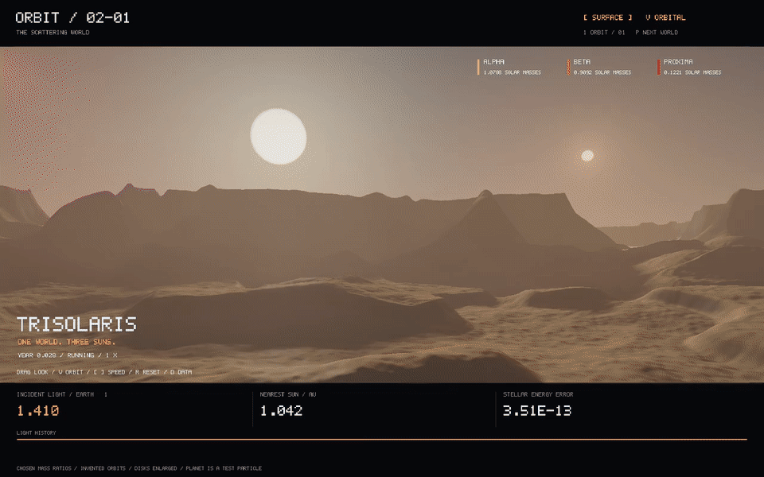

# Orbit-02-01 — The scattering world

[Play this world](../orbit-02.html?preset=02-01) · [Orbit catalogue](../ORBIT_02.md)

The original Orbit / 02 configuration is now **Orbit-02-01**. Numbering preserves
its initial state and trajectory; it does not turn it into a stable system.



The native GIF is **15 seconds, 960 × 600**, with eight seconds of terrain
followed by seven seconds of orbital view. Its playback advances 0.08 simulated
year per real second. The sky follows a prescribed 1.6-year planetary rotation.

## How we found it

This was the first fiction-inspired alien world built after Orbit / 01. We
used measured Alpha Centauri reference masses: **1.0788, 0.9092, 0.1221 solar
masses**. Their sources and the distinction from the novel's unverified physical
parameters are documented in the [original model notes](../ORBIT_02.md#what-masses-can-we-justify).

A/B start 4 AU apart with circular two-body relative velocity. Before recentering,
C starts at `(-1.5, 0.65, 6)` AU with velocity `(-3.1, -0.15, -0.7)` AU/year.
The massless planet starts at apoapsis of an osculating 0.90 AU orbit around A,
with eccentricity 0.16. These invented coordinates were chosen to produce
strongly changing illumination and a close stellar encounter.

## How we tuned it

The native and browser views share the same integrated star-to-planet
vectors. We added a rotating surface observer, terrain, haze, enlarged stellar
disks, trails, and light-history measurements. Rendering refinements removed
noise-cell seams and reduced repeated terrain banding. These visual choices
change neither the force law nor the initial state.

The underlying orbital configuration was retained as the scattering comparison
when we began investigating longer-lived worlds. Its initial stellar mutual
inclination is approximately 6.629°; the planet initially shares the inner
binary's orbital plane.

## How we tested it

The double precision solver uses G = 4π² in AU/solar-mass/year units and a
1/16384-year kick–drift–kick step. Numerical tests check forces, short-run
convergence, conservation, barycentre drift, contact handling, determinism, and
frame-rate independence. Export tests compare every bundled byte with a fresh
native export. Browser checks cover rendering, playback, camera switching,
telemetry, mobile layout, and sky-artifact regressions.

Over the 36-year recording, the closest stellar passage is about 0.178 AU and
maximum relative stellar energy error about 1.32 × 10⁻⁵. The planet travels far
outside the inner system. The stricter hierarchy-retention screen rejects this
state at year 3, even at the native timestep; that is not a claim that a star
escapes at year 3. See the [stability study](../STELLAR_STABILITY.md).

## Available track

The web player retains the original **36-year dense recording**, sampled every
1/512 year. A million-year compactness or planetary-retention claim does not
apply to this world, so no such replay is presented.

```bash
./run.sh --orbit 02-01
./build/orbit02_export doc/data/orbit-02
./tools/record-demo.sh 02-01
```

`--orbit 02` remains an alias for this world. Press **P** in the native alien
viewer to cycle numbered worlds; **V** switches terrain/orbital views.
