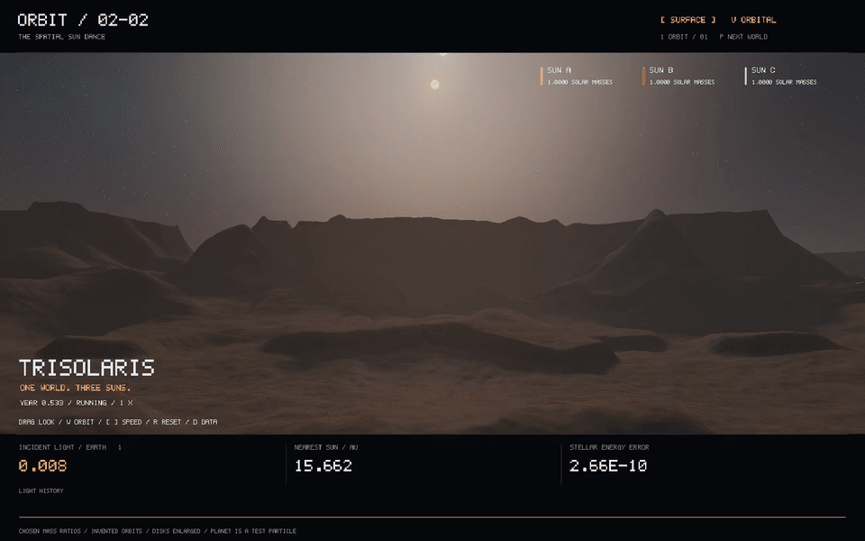

# Orbit-02-02 — The spatial sun dance

[Play this world](../orbit-02.html?preset=02-02) · [Orbit catalogue](../ORBIT_02.md)

Three equal-mass stars participate in a spatial choreography while the planet
orbits the whole triple. This is the configuration demonstrated in the
[three-sun research preview](../SUN_DANCE.md). Its masses are **1–1–1 solar
masses**; a **1–1–0.02** combination has not been validated or substituted here.



The native demo is **15 seconds, 960 × 600**: eight seconds on the terrain,
then seven seconds of orbital view, at **2 simulated years per real second**.
The physics starts from the same state as the research candidate.

## How we found it

A quiet hierarchy passed our first million-year study, but a more elaborate
sky was desirable. We looked for published nonhierarchical spatial solutions.
[Li & Liao, supplementary Table S4](https://arxiv.org/html/2508.08568v1)
provides a high-precision initial state for **O₃(1.0)**, classified by its authors
as linearly stable. We selected that reproducible starting point rather than
inventing periodic paths.

The dimensionless stellar state is scaled by **4 AU** and converted from G = 1
to G = 4π². Published `(x,y,z)` maps to project `(x,z,y)`, and the stellar
barycentre is removed. A/B initially lie 8 AU apart; the reference stellar period
is about **8.698291 years**. The source constants are explicit in
[`alien_catalog.hpp`](../../src/alien_catalog.hpp), and the manifests record the
exact initial positions and velocities.

## How we tuned it

An initially circular 16 AU circumsystem planet exceeded our 100 AU retention
boundary after about 8,382 years. Moving it initially to **20 AU**, inclined
20° to the project's XZ plane, produced the candidate used here. A 24 AU
comparison also survived. The stellar force law and paths were not prescribed,
looped, or reset at their published period.

Close approaches demanded better numerical accuracy. We used a **fourth-order
Yoshida composition** of the existing leapfrog routine at a 1/512-year macro
step. The catalogue uses solar physical contact radii for all three equal-mass
stars. The original research retained the earlier reference radii; the minimum
successful stellar separation exceeds 0.423 AU, far outside either radius set.
The final catalogue export repeats the full million-year calculation with the
catalogue's own radii and produces its own verification record.

For viewing, the planet has a prescribed observer at **60° latitude**, a rotation
period of approximately **51.64 years** in the planetary orbital sense, and an
initial phase pointing the site toward the stars. That period matches the
initial two-body circumsystem reference period. The camera initially faces the
flux-weighted sun directions. These are explicit observer/rotation choices,
not a change to the validated orbit or a simulated tidal-locking process.
They keep the sun dance visible during the terrain demonstration.

## How we tested it

The 20 AU candidate passed four **1,000,000-year** research trials: baseline,
half timestep, a 10⁻⁶ perturbation of opposite stellar velocity components,
and a planet starting 90° farther around its orbit. The stars stayed within
8.00004 AU of one another. In these trials the planet remained roughly
17.85–20.77 AU from their barycentre. These are finite sampled bounds, not an
indefinite stability proof.

An independent eight-year SciPy DOP853 comparison showed stellar and planetary
state errors decreasing by about sixteen when the macro step was halved,
consistent with fourth-order convergence. Routine regression tests check the
published periodic return, Newtonian scaling, barycentre/momentum, catalogue
identity, frame independence, and agreement with the research initial states
and preview samples. See the [full research and raw results](../SUN_DANCE.md).

The catalogue export separately checks contact, stellar compactness, negative
circumsystem osculating planetary energy, a 100 AU planetary-distance boundary,
and conservation every 1/16 year. Its measured extrema and completed step count
are saved in [verification.json](../data/orbit-02-02/verification.json).

## Available tracks

The web player provides five **64-year smooth detail windows**, starting at
**0, 250,000, 500,000, 750,000, and 999,936 years**, sampled every **1/128 year**.
It also provides the full **0–1,000,000-year survey**, sampled every **100 years**.
All positions come from a continuous C++ integration. The survey shows discrete
snapshots, forces orbital view, and disables connecting trails. It does not
interpolate an imaginary route between century-spaced positions. Choose a detail
window to watch the actual short-term motion; unrecorded gaps cannot be replayed
smoothly on the static site.

Under the assigned solar luminosities, this distant planet receives about
0.7–1% of Earth's incident flux. Terrain exposure, colours, and enlarged disks
are artistic. This is a cold dynamical candidate, not a validated habitable
Trisolaris or a set of canonical novel parameters. Stellar evolution, tides,
relativity, external encounters, and a climate model are omitted.

```bash
./run.sh --orbit 02-02
./build-headless/orbit_catalog_export doc/data
./tools/record-demo.sh 02-02
```
