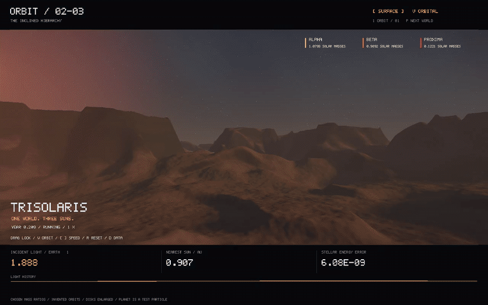

# Orbit-02-03 — The inclined hierarchy

[Play this world](../orbit-02.html?preset=02-03) · [Orbit catalogue](../ORBIT_02.md)

A compact inner binary, an inclined outer star, and a planet bound to A provide
a longer-lived comparison with Orbit-02-01. This is the **inclined-16** candidate
from the [first stability study](../STELLAR_STABILITY.md). Stellar masses remain
**1.0788, 0.9092, and 0.1221 solar masses**.



Its native demo is **15 seconds, 960 × 600**: eight seconds of terrain and seven
seconds of orbital view, at **0.8 simulated year per real second**. The prescribed
surface rotation period is 8 years. The initial camera faces the incoming light.

## How we found it

The original world scattered too quickly to meet the million-year target. We
reviewed empirical work on hierarchical triples and inclined planetary systems,
then built candidate states in Jacobi coordinates: an inner A/B relative orbit,
C relative to their barycentre, and a planet relative to A. The construction
includes stellar recoil and uses the correct total mass for each initial orbit.
The references and parameter screen are in the [stability report](../STELLAR_STABILITY.md).

## How we tuned it

We compared outer stellar semimajor axes of 12, 16, 24, and 32 AU around an
inner **4 AU** binary. The 12 AU case failed the hierarchy-retention envelope
before a million years at both tested resolutions. The **16 AU** candidate was
the most compact successful choice in that search. It uses inner eccentricity
0.05, outer eccentricity 0.10, and **20° stellar mutual inclination**.

The planet initially has semimajor axis **0.90 AU**, eccentricity **0.03**, and
**10° inclination** to the inner binary plane. Nodes, periapsides, and starting
phases remain exactly those of `inclined-16` in
[`stability.hpp`](../../src/stability.hpp); they were not adjusted to make the GIF.
The 8-year surface rotation and playback rate are viewing choices.

## How we tested it

Four **1,000,000-year** trials passed: baseline, a halved timestep, and two
nearby cases jointly changing outer/planetary true anomalies by ±1° and outer
inclination by ±1°. The sampled maximum stellar separation stayed below
19.69 AU, planetary eccentricity below 0.095, and incident flux approximately
1.617–2.176 times Earth's. Only these selected cases were tested; this is not
an exhaustive stability map or a proof of indefinite survival.

An independent 128-year DOP853 integration checked the inner, outer, and
planetary osculating elements. Step halving reduced leapfrog errors by about
four, as expected for second-order integration. Numerical and catalogue tests
verify barycentre/momentum, encoded inclinations, state identity, frame-rate
independence, and physical contact handling. See the
[results and limitations](../STELLAR_STABILITY.md).

The catalogue uses the validated **1/512-year leapfrog step** and repeats the
million-year integration for its playback data. It checks contact, stellar
compactness, planet binding to A, the 5 AU planet-distance boundary, and
conservation every 1/16 year. Its [verification record](../data/orbit-02-03/verification.json)
contains the completed duration, step count, and sampled extrema. The earlier
research also applied a stricter semimajor-axis envelope; the catalogue's
planet-retention check is described explicitly rather than conflated with it.

## Available tracks

Five **64-year detail windows** begin at **0, 250,000, 500,000, 750,000, and
999,936 years**, with samples every **1/128 year**. The **million-year survey**
contains computed snapshots every **100 years**. Survey playback uses orbital
view and never interpolates or joins trails across the large gaps. Use a detail
window for smooth sky motion, including at the end of the million-year run.

The model includes a massless planet and Newtonian point-mass gravity with
contact radii. It omits tides, relativity, stellar evolution, external encounters,
and climate. A hierarchy this well retained does not demonstrate the story's
repeated transfers of the planet between suns. Its incoming-light measurement
is not a habitability result.

```bash
./run.sh --orbit 02-03
./build-headless/orbit_catalog_export doc/data
./tools/record-demo.sh 02-03
```
